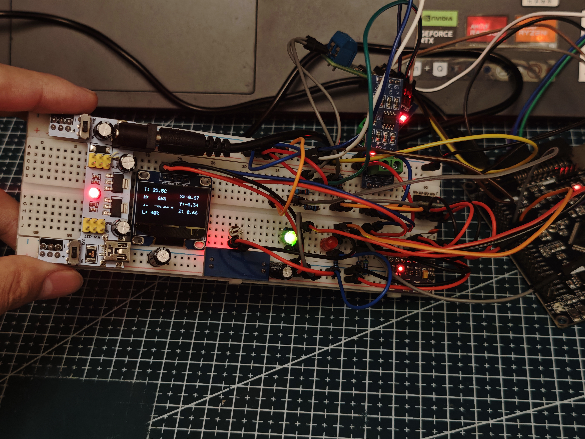

# f407-sensor-node

> STM32F407VET6 工业数据采集节点（网关南向基础）· SHT3X / GY-91 / ACS712 / GL5516 · OLED + Modbus RTU + CAN + USB CDC

## 项目概述

**f407-sensor-node** 是一个基于 STM32F407VET6 的**工业数据采集节点**——工业网关的南向（协议接入）基础。它通过 I²C 总线挂载温湿度、九轴姿态传感器，通过 ADC+DMA 采集电流与光照，数据在 FreeRTOS 四任务调度下实时采集，输出到三条链路：**OLED 本地显示**（心跳指示 + 左右分栏排版）、**RS485 Modbus RTU**（上位机读取 7 个寄存器）、**CAN 总线**（每秒广播 ID=0x100 报文）。掌握 Modbus RTU 帧解析、CAN 报文、RS485 半双工——即工业网关的核心协议接入能力。

> 全链路调试流程与 17 个真实踩坑案例见 `docs/` 目录（含调试方法论的完整记录）。

---

## 技术栈

| 层面 | 技术 |
|------|------|
| **MCU** | STM32F407VET6 (Cortex-M4F) @ 168MHz |
| **RTOS** | FreeRTOS (CMSIS_RTOS_V2) · 4 任务 + Mutex + 信号量 |
| **传感器** | SHT3X (I²C 0x44) · GY-91/MPU-6500 (I²C 0x68) · ACS712 (ADC) · GL5516 (ADC) |
| **显示** | SSD1306 OLED 128×64 (I²C 0x3C) |
| **通信** | RS485 Modbus RTU 从站 (USART6) · CAN 2.0B 500kbps (CAN1) · USB CDC |
| **开发环境** | STM32CubeMX 6.15 → CMake + Ninja → CLion · arm-none-eabi-gcc 14.3.1 · ST-Link v2 |

---

## 硬件

| 组件 | 规格 | 数量 |
|------|------|:--:|
| 主控 | STM32F407VET6 开发板 (F4VE V2.0) | 1 |
| 温湿度 | SHT3X | 1 |
| 姿态 | GY-91 模块 (实测芯片 = MPU-6500) | 1 |
| 电流 | ACS712 | 1 |
| 光照 | GL5516 光敏电阻模块 | 1 |
| 显示 | SSD1306 OLED 1.3" 128×64 | 1 |
| 总线 | MAX485 (RS485) · TJA1050 (CAN) | 各 1 |
| 调试器 | ST-Link v2 | 1 |

### 关键接线

| 外设 | 引脚 | 说明 |
|------|------|------|
| I²C1 (SHT3X/GY-91/OLED) | PB6=SCL, PB7=SDA | 三设备并联同总线 |
| ADC1 | PA0=ACS712, PA1=GL5516 | DMA 半字双通道循环 |
| USART6 (Modbus) | PC6=TX, PC7=RX, PC4=RE/DE | MAX485（⚠️ 本板 APB1 域 USART2/3+CAN1 外设损坏，485 迁至 APB2 域 USART6） |
| CAN1 | PD0=RX, PD1=TX | TJA1050 |
| USB OTG FS | PA9/PA11/PA12 | CDC 虚拟串口 |
| LED | PD12=红(错误), PD13=绿(心跳) | 状态指示 |

---

## 软件架构

**三层分区**（职责严格分离）：

```
Core/
├── drivers/   只调 HAL，不调 FreeRTOS（SHT3X/GY-91/SSD1306/ACS712/...）
├── app/       调 drivers + FreeRTOS，不直接调 HAL（4 个任务 + 协议）
└── utils/     纯 C 算法（环形缓冲 / CRC16）
```

**FreeRTOS 任务**：

| 任务 | 优先级 | 周期 | 职责 |
|------|:---:|:---:|------|
| modbusTask | High | 事件驱动 | Modbus RTU 从站应答 |
| sensorTask | Normal | 100ms | 采集全部传感器（I²C 锁保护） |
| canTask | Normal | 1s | CAN 广播传感器帧 |
| displayTask | Low | 500ms | OLED 刷新 + LED 心跳/错误指示 |

**关键设计**：
- `sensorDataMutex` 保护全局数据；`i2c1Mutex` 防止 OLED 刷新与传感器采集抢 I²C 总线
- ADC 双通道 DMA 半字循环打包读法（低 16 位=PA0，高 16 位=PA1）+ 连续转换模式
- ACS712 上电自动零点校准（32 次采样取平均）
- GY-91 实测芯片为 MPU-6500（假模块），驱动按 WHO_AM_I(0x75)=0x70 适配，无 Bank 机制
- OLED 左右分栏排版：左列指标（页 0/2/4/6）+ 右列 XYZ（行间距空隙页 1/3/5，两位小数 g 单位）
- 调试方法论：调试器内存级读写诊断（WHO_AM_I 探针、寄存器读回验证、framebuffer 解码）

---

## 构建与烧录

```bash
# 构建
cmake --preset Debug
ninja -C build/Debug

# 烧录（CLion F5 或 CLI）
STM32_Programmer_CLI -c port=SWD mode=UR \
  -w build/Debug/F407_SensorNode.elf 0x08000000 -rst
```

## 文档

| 文档 | 内容 |
|------|------|
| `docs/项目A调试流程手册.docx` | 外设分步测试操作手册（工具/接线/预期现象/排查） |
| `docs/项目A踩坑记录.docx` | 17 个真实踩坑案例：现象 → 诊断 → 根因 → 解决 → 教训 |

---

## 实物照片与验证截图

> 原始图片放入 `docs/images/`（文件名按下列引用一致）。未拍摄/未上传的留空位，拍好替换即可，无需改文字。

### 1. 硬件全景（面包板接线 + OLED 正常显示）



> 整机接线全貌 + OLED 正常运行显示（FreeRTOS 四任务调度工作状态）。

### 2. RS485 发送链路验证 — PC6 波形（逻辑分析仪 D0 通道）


> 逻辑分析仪抓 PC6（USART6_TX @ 115200-8N1），数据帧波形（起始位/数据位可见）。

### 3. RS485 发送链路验证 — UART 解码结果


> UART 协议解码：`01 03 00 00 00 07 04 08` = 从站地址 01 + 功能码 03（读保持寄存器）+ 起始寄存器 0x0000 + 数量 0x0007 + CRC-16 正确。即 **Modbus RTU 读请求帧**发送完整正确 —— MCU 侧链路全通。MAX485 模块侧（DI/DE 接线、模块本体）待验证。

### 4. CAN 总线验证（预留空位）


> 预留：CAN 报文解码截图（ID=0x100 传感器广播帧）。⚠️ 本板 CAN1 外设已确诊损坏（APB1 域，与 USART2/3 同一故障区），抓不到 CAN 波形属硬件问题；待拿到好板烧录本固件后补拍。
