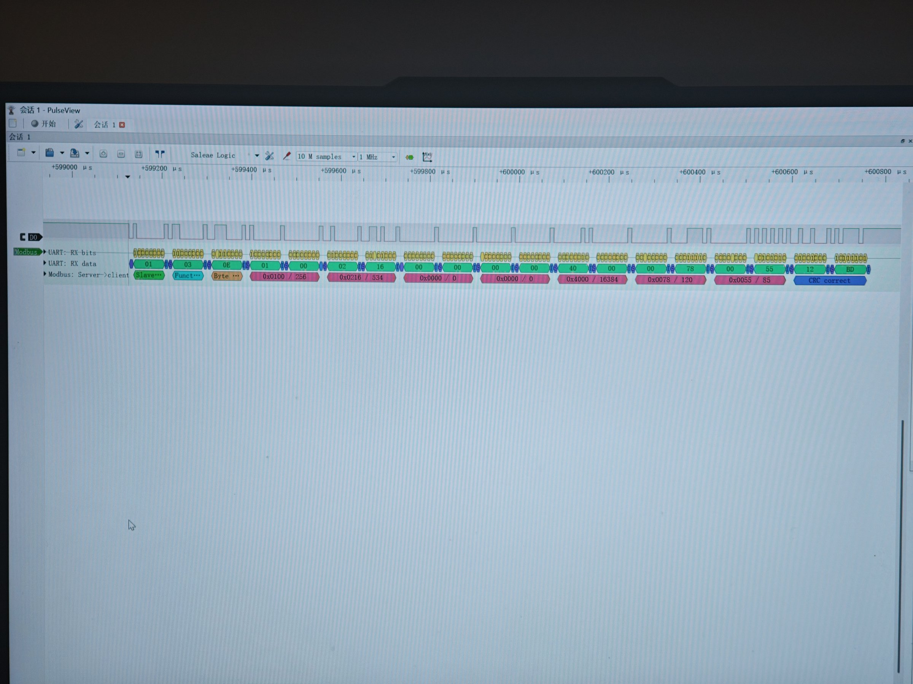
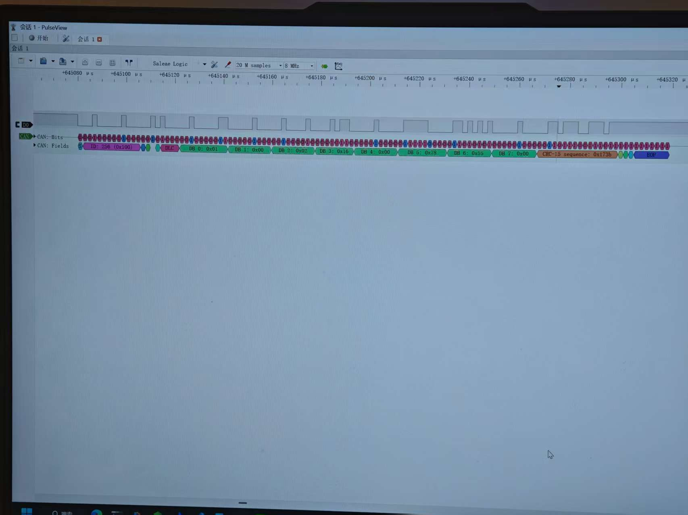

# f407-sensor-node

> STM32F407VET6 工业数据采集节点（网关南向基础）· SHT3X / GY-91 / ACS712 / GL5516 · OLED + Modbus RTU + CAN + USB CDC

## 项目概述（原理与实现）

**f407-sensor-node** 是一个基于 STM32F407VET6 的**工业数据采集节点**——工业网关的南向（协议接入）基础。

**实现原理 / 数据流**：

```
传感器层     SHT3X(温湿度) · GY-91/MPU-6500(九轴姿态) · ACS712(电流) · GL5516(光照)
    ↓  I²C 总线 / ADC+DMA
采集层       SensorTask 每 100ms 采集一轮, 写入 g_sensor_data (Mutex 保护)
    ↓
调度层       FreeRTOS 四任务: sensor / modbus / can / display
    ↓
输出层       OLED 本地显示 · RS485 Modbus RTU 从站(7 寄存器) · CAN 广播(ID=0x100)
```

- I²C 总线挂载温湿度（SHT3X 0x44）与九轴姿态（GY-91/MPU-6500 0x68），ADC+DMA 采集电流（ACS712 PA0）与光照（GL5516 PA1）
- `sensorDataMutex` 保护全局数据，`i2c1Mutex` 防止 OLED 刷新与传感器采集抢 I²C 总线
- 数据输出三条链路：**OLED 本地显示**（心跳指示 + 左右分栏排版）、**RS485 Modbus RTU**（从站应答 7 个寄存器）、**CAN 总线**（每秒广播 ID=0x100 报文）

---

## 实物照片与验证截图

### 1. 硬件全景（板子运行状态）


> 整机接线全貌 + OLED 正常运行（FreeRTOS 四任务调度工作状态）。

**OLED 屏幕显示内容**（拍照时可见）：

| 显示项 | 数据来源 | 说明 |
|--------|----------|------|
| 温度 / 湿度 | SHT3X (I²C 0x44) | 温湿度传感器 |
| 光照 % | GL5516 (ADC PA1) | 光敏电阻 |
| 姿态 XYZ | GY-91 模块 (实测芯片=MPU-6500, I²C 0x68) | 三轴加速度 |

**板载 LED 状态指示**：

| LED | 引脚 | 含义 |
|-----|------|------|
| 绿 LED | PD13 | 心跳：每秒翻转，系统调度运行正常 |
| 红 LED | PD12 | 错误：任一外设（SHT3X / GY-91 / ADC）读取失败即点亮，指示异常模块 |

> 模块断线时红 LED 点亮——这是快速判断"哪个外设掉线"的硬件指示。

**各模块作用一览**：SHT3X 温湿度采集 · GY-91/MPU-6500 姿态采集（假模块按 WHO_AM_I=0x70 适配）· ACS712 霍尔电流检测 · GL5516 光照强度 · SSD1306 OLED 本地显示 · MAX485 转 RS485 半双工 · TJA1050 转 CAN 总线。

### 2. RS485 Modbus 发送链路验证 — 波形 + 解码



> 逻辑分析仪抓 PC6（USART6_TX @ 115200-8N1），Modbus RTU **应答帧**：
> `01 03 0E [14字节数据] [CRC-16]` = 从站地址 01 + 功能码 03（读保持寄存器）+ 数据字节数 0x0E（14）+ 7 个寄存器数据（温度×10、湿度×10、加速度 XYZ、电流 mA、光照 %）+ CRC-16 正确。
>
> 演示固件每 100ms 循环发送该应答帧，数据排布与正式代码 `modbus_protocol.c` 的 `reg_read` 完全一致 —— MCU 侧收发链路全通。

### 3. CAN 发送链路验证 — 波形 + 解码



> 逻辑分析仪抓 CAN1_TX（PD1），**ID=0x100，500kbps，标准帧 8 字节数据 `01 00 02 16 00 78 55 00`**（温度 25.6°C / 湿度 53.4% / 电流 120mA / 光照 85%），PulseView 解码全部正确（CRC 校验通过）—— CAN 发送链路与帧格式全通。

---

## 技术栈

| 层面 | 技术 |
|------|------|
| **MCU** | STM32F407VET6 (Cortex-M4F) @ 168MHz |
| **RTOS** | FreeRTOS (CMSIS_RTOS_V2) · 4 任务 + Mutex + 信号量 |
| **传感器** | SHT3X (I²C 0x44) · GY-91/MPU-6500 (I²C 0x68) · ACS712 (ADC) · GL5516 (ADC) |
| **显示** | SSD1306 OLED 128×64 (I²C 0x3C) |
| **通信** | RS485 Modbus RTU 从站 (USART6) · CAN 2.0B 500kbps (CAN1) · USB CDC |
| **开发环境** | STM32CubeMX 6.15 → CMake + Ninja → CLion · arm-none-eabi-gcc 14.3.1 · ST-Link v2 |

## 硬件与关键接线

| 组件 | 规格 | 数量 |
|------|------|:--:|
| 主控 | STM32F407VET6 开发板 (F4VE V2.0) | 1 |
| 温湿度 | SHT3X | 1 |
| 姿态 | GY-91 模块 (实测芯片 = MPU-6500) | 1 |
| 电流 | ACS712 | 1 |
| 光照 | GL5516 光敏电阻模块 | 1 |
| 显示 | SSD1306 OLED 1.3" 128×64 | 1 |
| 总线 | MAX485 (RS485) · TJA1050 (CAN) | 各 1 |
| 调试器 | ST-Link v2 | 1 |

| 外设 | 引脚 | 说明 |
|------|------|------|
| I²C1 (SHT3X/GY-91/OLED) | PB6=SCL, PB7=SDA | 三设备并联同总线 |
| ADC1 | PA0=ACS712, PA1=GL5516 | DMA 半字双通道循环 |
| USART6 (Modbus) | PC6=TX, PC7=RX, PC4=RE/DE | MAX485（RS485 使用 APB2 域 USART6） |
| CAN1 | PD0=RX, PD1=TX | TJA1050 |
| USB OTG FS | PA9/PA11/PA12 | CDC 虚拟串口 |
| LED | PD12=红(错误), PD13=绿(心跳) | 状态指示 |

## 软件架构

**三层分区**（职责严格分离）：

```
Core/
├── drivers/   只调 HAL，不调 FreeRTOS（SHT3X/GY-91/SSD1306/ACS712/...）
├── app/       调 drivers + FreeRTOS，不直接调 HAL（4 个任务 + 协议）
└── utils/     纯 C 算法（环形缓冲 / CRC16）
```

**FreeRTOS 任务**：

| 任务 | 优先级 | 周期 | 职责 |
|------|:---:|:---:|------|
| modbusTask | High | 事件驱动 | Modbus RTU 从站应答 |
| sensorTask | Normal | 100ms | 采集全部传感器（I²C 锁保护） |
| canTask | Normal | 1s | CAN 广播传感器帧 |
| displayTask | Low | 500ms | OLED 刷新 + LED 心跳/错误指示 |

**关键设计**：
- `sensorDataMutex` 保护全局数据；`i2c1Mutex` 防止 OLED 刷新与传感器采集抢 I²C 总线
- ADC 双通道 DMA 半字循环打包读法（低 16 位=PA0，高 16 位=PA1）+ 连续转换模式
- ACS712 上电自动零点校准（32 次采样取平均）
- GY-91 实测芯片为 MPU-6500（假模块），驱动按 WHO_AM_I(0x75)=0x70 适配，无 Bank 机制
- OLED 左右分栏排版：左列指标（页 0/2/4/6）+ 右列 XYZ（行间距空隙页 1/3/5，两位小数 g 单位）
- 调试方法论：调试器内存级读写诊断（WHO_AM_I 探针、寄存器读回验证、framebuffer 解码）

## 构建与烧录

```bash
# 构建
cmake --preset Debug
ninja -C build/Debug

# 烧录（CLion F5 或 CLI）
STM32_Programmer_CLI -c port=SWD mode=UR \
  -w build/Debug/F407_SensorNode.elf 0x08000000 -rst
```

## 拼装教程

见 `docs/项目A_拼装教程.docx`：以开发板为基础，按"引脚配外设 → 模块接线 → 模块串联"的步骤搭建整套硬件，含每个模块的接线引脚与上电验证现象。

## 踩坑记录

见 `docs/项目A踩坑记录.docx`：25 个真实调试踩坑案例，结构为 **现象 → 诊断 → 根因 → 解决 → 教训**（如：假 GY-91 模块冒充 ICM-20948、I²C 死锁 9 时钟脉冲恢复、Modbus 帧被 DMA 半传输中断切半、OLED 花屏等）。

## 文档索引

| 文档 | 内容 |
|------|------|
| `docs/项目A调试流程手册.docx` | 外设分步测试操作手册（工具/接线/预期现象/排查） |
| `docs/项目A踩坑记录.docx` | 25 个真实踩坑案例：现象 → 诊断 → 根因 → 解决 → 教训 |
| `docs/项目A_拼装教程.docx` | 开发板搭建：引脚配外设 → 接线 → 模块串联 |